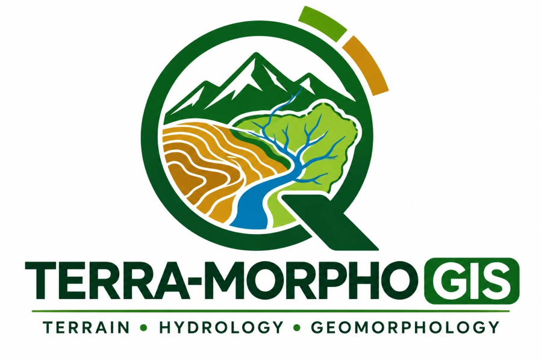

# TERRA-MORPHO GIS, extension QGIS



Anciennement GeoPhysique & Environnement.

Version : **2.1.0**. Auteur : Allaye GUINDO. Licence GPL-2.0 ou ultérieure.

L'extension réalise dans QGIS des analyses topographiques, morphométriques, géomorphologiques et hydrologiques à partir d'un MNT. Elle délimite les bassins et sous-bassins versants, trace des profils, produit des cartes mises en page et exporte ses statistiques.

## Compatibilité

- QGIS 3.34 à 4.x. Testée sur QGIS 3.44.12 (Qt 5.15) ; pas encore testée sous QGIS 4 / Qt6.
- NumPy et SciPy, fournis avec QGIS, sont obligatoires. Matplotlib sert aux graphiques et openpyxl à l'export Excel (une écriture XLSX minimale prend le relais s'il manque).
- GRASS, SAGA et WhiteboxTools sont facultatifs : le tableau de bord indique ceux qui sont actifs.

## Installation

Depuis QGIS : **Extensions > Installer depuis un ZIP**, puis ouvrir **Extensions > TERRA-MORPHO GIS > TERRA-MORPHO GIS** ou cliquer sur l'icône de la barre d'outils.

## Utilisation

Choisir le MNT en haut du panneau. Il doit être dans un SCR projeté en mètres ; sinon, la rubrique « Gestion des MNT » le reprojette en UTM. Chaque rubrique lance son calcul en tâche de fond, ajoute les couches stylées au projet dans le groupe « TERRA-MORPHO GIS » et propose la zone « Résultats - Statistiques - Exportation ».

| Rubrique | Contenu |
|---|---|
| Tableau de bord | Moteurs disponibles, analyses de la session, exportation globale |
| Gestion des MNT | Contrôles (SCR, unités, résolution, NoData, altitudes), reprojection UTM, découpage par masque |
| Analyse topographique | Statistiques altimétriques, hypsométrie, pentes (° et %), classes FAO, expositions, ombrages, courbes de niveau, relief relatif, rugosité, ruptures de pente |
| Analyse morphométrique | TPI, TRI, VRM, RSP fenêtrée, TWI, SPI, LS, intégrale hypsométrique locale, indice de dissection, unités morphométriques |
| Analyse géomorphologique | 7 courbures, surfaces concaves et convexes, formes de versant, éléments de Wood, unités de Weiss, crêtes et talwegs |
| Analyse hydrologique | Comblement des dépressions, directions D8, MFD, D-Infinity, accumulations, longueurs d'écoulement, convergence, réseau (Strahler, Shreve), confluences |
| Bassins versants | Exutoire par clic, coordonnées ou couche de points, recalage optionnel ; délimitation automatique |
| Sous-bassins versants | Confluences, ordre de Strahler, superficie minimale, seuil propre, points de contrôle ; relations amont-aval |
| Profils topographiques | Tracé sur la carte, lignes d'une couche ou cours d'eau principal ; comparaison et exports |
| Cartographie automatique | Cartes A4 avec titre, légende, échelle, nord, SCR, sources, méthode et date ; atlas PDF |
| Statistiques | Consultation des tableaux, comparaison des bassins, exports |
| Paramètres | Répertoire de sortie, séparateurs CSV, sources et mention de réalisation des cartes |

Les méthodes, formules et références sont détaillées dans [docs/METHODES.md](docs/METHODES.md).

## Points de vigilance

- Le comblement complet supprime aussi les dépressions naturelles. L'option « limitée en profondeur » ou « aucune correction » les conserve.
- Le seuil du réseau dépend de l'emprise et de la résolution : la valeur suggérée est un point de départ à ajuster.
- La position de l'exutoire et le rayon de recalage changent le bassin obtenu. Sur le MNT de Wegnia, un recalage de 90 m place l'exutoire sur la branche du lac (402 km²) et un recalage de 200 m sur l'exutoire du bassin complet (1149 km²). Les deux exutoires, initial et corrigé, sont tracés pour le contrôle.
- Les temps de concentration (Kirpich, Giandotti) sont des estimations empiriques.

## Tests

```bash
python-qgis-ltr.bat GeoPhysiqueEnvironnement/tests/test_core.py
python-qgis-ltr.bat GeoPhysiqueEnvironnement/tests/test_workflows.py <mnt.tif> <dossier>
python-qgis-ltr.bat GeoPhysiqueEnvironnement/tests/test_gui.py <mnt.tif> <dossier> [x y]
```

`test_core.py` vérifie notamment que le comblement donne exactement le résultat d'un Priority-Flood de référence et que les trois méthodes d'accumulation conservent les volumes.
