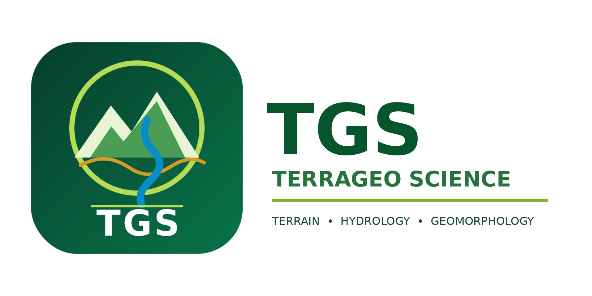

# TGS - TerraGeo Science (extension QGIS)



Anciennement GeoPhysique & Environnement, puis TERRA-MORPHO GIS. Le dossier technique `GeoPhysiqueEnvironnement` est conservé.

TGS - TerraGeo Science, extension QGIS d'Allaye GUINDO pour la géographie physique, l'hydrologie et la morphométrie. À partir d'un MNT, elle calcule les produits topographiques, morphométriques et géomorphologiques, route les écoulements (D8, MFD, D-Infinity), délimite bassins et sous-bassins avec leurs paramètres morphométriques, trace des profils et exporte cartes et statistiques. Le détail des rubriques est dans le [README de l'extension](GeoPhysiqueEnvironnement/README.md) et les formules dans [docs/METHODES.md](GeoPhysiqueEnvironnement/docs/METHODES.md).

Contrôlez les résultats avant toute interprétation scientifique.

## Installation

Depuis QGIS : **Extensions > Installer/Gérer les extensions** puis chercher « TGS ».

Installation manuelle : télécharger le zip de la dernière version dans l'onglet *Releases*, puis **Extensions > Installer depuis un ZIP**.

QGIS 3.34 ou plus récent est requis (QGIS 4 déclaré compatible, non testé). NumPy et SciPy, fournis avec QGIS, suffisent ; GRASS, SAGA et WhiteboxTools sont facultatifs.

## Contenu du dépôt

- `GeoPhysiqueEnvironnement/` : le code de l'extension, tel qu'il est installé dans QGIS. Son [README](GeoPhysiqueEnvironnement/README.md) détaille l'utilisation et les limites hydrologiques.
- `empaqueter.py` : produit le zip à envoyer sur plugins.qgis.org, dans `dist/`.

## Construire le zip

```bash
python empaqueter.py
```

## Signaler un problème

Ouvrir un ticket dans l'onglet *Issues* de ce dépôt.

## Licence

GPL-2.0 ou ultérieure, voir [LICENSE](LICENSE).
